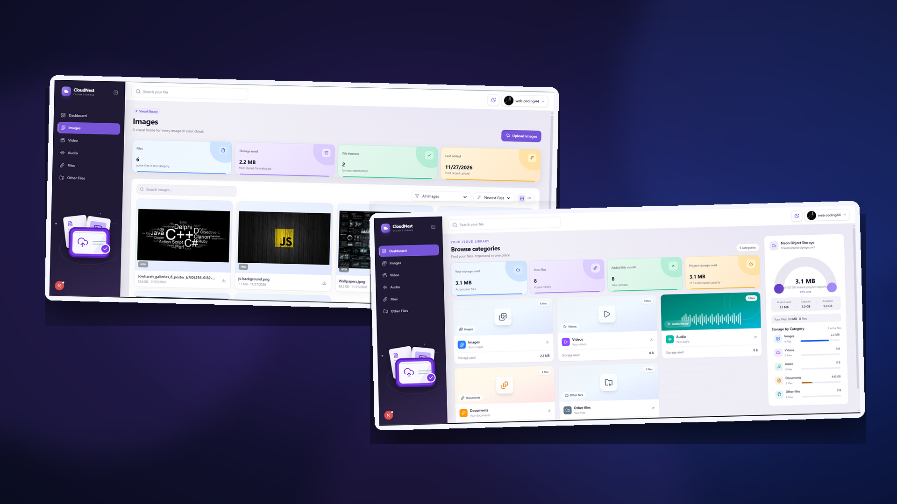
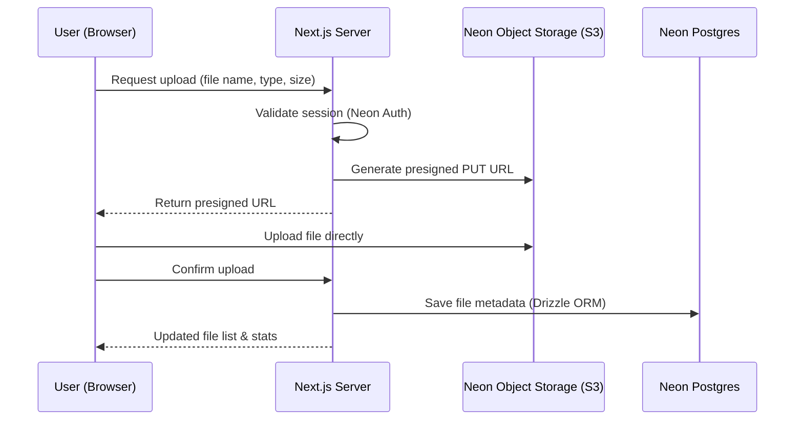

<div align="center">

# ☁️ CloudNest

### Cloud Storage & File Management Dashboard



A modern, fast and beautiful dashboard for storing, organizing and previewing your images, videos, audio, documents and any other files, powered by **Next.js** and **Neon**.

<p align="center">
  <a href="https://nextjs.org/"></a>&emsp;
  <a href="https://react.dev/"></a>&emsp;
  <a href="https://neon.com/"></a>&emsp;
  <a href="https://orm.drizzle.team/"></a>
  <br />
  <sub>
    <b>Next.js 16</b> &nbsp;·&nbsp;
    <b>React 19</b> &nbsp;·&nbsp;
    <b>Neon Postgres</b> &nbsp;·&nbsp;
    <b>Drizzle ORM</b>
  </sub>
</p>

<p align="center">
  
</p>

</div>

## ✨ Features

- 📁 **Smart categories**: files are organized automatically into Images, Videos, Audio, Documents and Other Files.
- ⬆️ **Fast uploads**: direct-to-storage uploads using S3 presigned URLs.
- 🖼️ **Visual library**: grid and list views with image previews, file name, size and upload date.
- 🔎 **Search, filter & sort**: find files instantly and sort by newest first.
- 📊 **Storage analytics**: total storage used, file count, files added this month and per-category usage.
- 🧮 **Quota overview**: a gauge showing used vs. available capacity of the shared project storage (e.g. 5 GB).
- ⬇️ **Secure downloads**: time-limited presigned download links.
- 🔐 **Authentication**: user sign-in and session handling with Neon Auth.
- 🌗 **Light / Dark mode**: theme switching with `next-themes`.
- 🎞️ **Smooth animations**: polished UI transitions with Motion.
- 📱 **Responsive design**: works on desktop, tablet and mobile.

---

## 🧰 Tech Stack

| Layer | Technology |
|---|---|
| Framework | [Next.js 16](https://nextjs.org/) (App Router) |
| UI | [React 19](https://react.dev/), [Motion](https://motion.dev/), [Lucide React](https://lucide.dev/) |
| Theming | [next-themes](https://github.com/pacocoursey/next-themes) |
| Database | [Neon Postgres](https://neon.tech/) via `@neondatabase/serverless` and `pg` |
| ORM | [Drizzle ORM](https://orm.drizzle.team/) |
| Object Storage | Neon Object Storage (S3-compatible) via `@aws-sdk/client-s3` |
| Presigned URLs | `@aws-sdk/s3-request-presigner` |
| Auth | `@neon/auth` |
| Config / Env | `@neon/config`, `@neon/env`, `dotenv` |

---

## 🏗️ Architecture



**Why presigned URLs?**
Files go straight from the browser to object storage, so your server isn't a bottleneck and credentials are never exposed to the client.

---

## 🚀 Getting Started

### Prerequisites

- Node.js **18.18+** (Node 20+ recommended)
- A [Neon](https://neon.tech/) account with a Postgres project and Object Storage enabled
- npm, pnpm or yarn

### 1. Clone the repository

```bash
git clone https://github.com/<your-username>/cloudnest.git
cd cloudnest
```

### 2. Install dependencies

```bash
npm install
```

### 3. Configure environment variables

Create a `.env` file in the project root. **The variable names below are examples, so adjust them to match your code.**

```env


DATABASE_URL=""

DATABASE_URL_UNPOOLED=""

NEON_BRANCH=
NEON_BRANCH_ID=
NEON_FUNCTION_HOST_SUFFIX=
NEON_AUTH_BASE_URL=
NEON_AUTH_JWKS_URL=

AWS_ACCESS_KEY_ID=
AWS_SECRET_ACCESS_KEY=
AWS_ENDPOINT_URL_S3=
AWS_REGION=
NEON_AUTH_COOKIE_SECRET=

NEON_STORAGE_BUCKET=
```

> ⚠️ Never commit your `.env` file. Make sure it's listed in `.gitignore`.

### 4. Set up the database

```bash
npx drizzle-kit push
```

### 5. Run the development server

```bash
npm run dev
```

Open [http://localhost:3000](http://localhost:3000) 🎉

---

<div align="center">

Made with ❤️ using Next.js & Neon

⭐ If you like this project, give it a star!

</div>